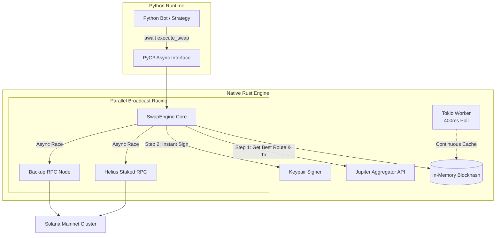

# Solana Flash Swap ⚡

[](https://www.rust-lang.org/)
[](https://www.python.org/)
[](https://pyo3.rs/)
[](https://solana.com/)
[](https://jup.ag)
[](LICENSE)

An ultra-high-performance, low-latency Solana DEX token swap engine engineered in **Rust** with native asynchronous **Python** bindings via **PyO3**. 

Designed for quantitative trading desks, arbitrageurs, and high-frequency memecoin sniper bots who require the ease and flexibility of Python combined with the zero-cost abstractions, multi-threaded safety, and microsecond-level execution of Rust.

---

## 🚀 Key Highlights & Architectural Advantages

- **Hybrid Rust + Python Core**: Write simple Python `async/await` scripts while offloading heavy networking, serialization, signing, and RPC racing to an optimized native binary.
- **Pre-warmed Blockhash Caching**: Dedicated background Tokio worker continuously refreshes the latest blockhash every `400ms`. Eliminates 100–300ms of latency during transaction compilation.
- **Dual-RPC Broadcast Racing**: Concurrently fires transactions to both **Helius** and a secondary backup RPC (`skip_preflight = true`). The fastest responding node confirms the block, drastically reducing dropped transactions during network congestion.
- **Automatic Priority Fees & Dynamic Compute Units**: Jupiter integration requests optimal priority fee lamports and enables `dynamicComputeUnitLimit`, minimizing gas costs while securing immediate block landing.
- **Microsecond Rate Throttling**: Built-in mutex timestamp guard prevents nonce collision, signature overwriting, or RPC rate-limit penalties when firing concurrent swaps.
- **Resilient Retry Loop**: Optional automated retry with configurable backoff delay.

---

## 🏛️ System Architecture



---

## ⚡ Performance Comparison

| Operation | Standard Python (`solders` / `solana-py`) | `solana-flash-swap` (Rust + PyO3) | Improvement |
| :--- | :--- | :--- | :--- |
| **Blockhash Fetching** | Synchronous RPC call (100–350ms) | In-memory atomic cache (< 0.01ms) | **~300x faster** |
| **Tx Deserialization & Signing** | Python object overhead (5–20ms) | Zero-copy native bincode (< 0.2ms) | **~50x faster** |
| **RPC Broadcasting** | Single RPC sequentially | Dual RPC simultaneous racing | **Dramatically higher landing rate** |
| **Binary Optimization** | Interpreted bytecode | LTO + `opt-level = 3` + Native machine code | **Near-zero CPU latency** |

---

## 📦 Directory Structure

```text
├── Cargo.toml            # Rust package & release profile configurations (LTO, opt-level=3)
├── src/
│   ├── lib.rs            # Core SwapEngine, dual-broadcast racing & blockhash cache worker
│   ├── jupiter.rs        # Jupiter Quote & Swap API communication
│   ├── python.rs         # PyO3 module interface and async Python bindings
│   ├── config.rs         # Environment variable parser and application config
│   └── utils.rs          # Lamport unit conversions & ATA balance utilities
├── test.py               # Production-ready Python example script
├── .env.example          # Environment variables template
├── .gitignore            # Clean git exclusion rules
└── README.md             # Project documentation
```

---

## 🛠️ Prerequisites

Ensure you have the following installed on your machine:

1. **Rust & Cargo** (v1.75+ recommended):
   ```bash
   curl --proto '=https' --tlsv1.2 -sSf https://sh.rustup.rs | sh
   ```
2. **Python** (v3.9 or higher):
   ```bash
   python3 --version
   ```
3. **Maturin** (Recommended build tool for PyO3 packages):
   ```bash
   pip install maturin
   ```

---

## 🔧 Installation & Build

### Option 1: Build & Install with Maturin (Recommended)

To compile the Rust engine and install it directly into your current Python virtual environment:

```bash
# Clone the repository
git clone https://github.com/methun404/solana-flash-swap.git
cd solana-flash-swap

# Compile with maximum release optimizations
maturin develop --release
```

### Option 2: Compile with Cargo Directly

```bash
cargo build --release
```
The compiled shared library will be generated in `target/release/`:
- macOS: `libsolana_flash_swap.dylib`
- Linux: `libsolana_flash_swap.so`
- Windows: `solana_flash_swap.dll`

---

## ⚙️ Configuration Setup

Create your `.env` file by copying the provided example:

```bash
cp .env.example .env
```

Edit `.env` with your credentials:

```ini
# Primary RPC Key (Helius)
HELIUS_API_KEY=your_helius_api_key_here

# Backup RPC endpoint
BACKUP_RPC_URL=https://api.mainnet-beta.solana.com

# Optional Jupiter API key for higher rate limits
JUPITER_API_KEY=

# Local wallet keypair path
WALLET_PATH=./my-wallet.json

# Slippage tolerance in basis points (50 = 0.5%, 100 = 1.0%)
SLIPPAGE_BPS=50
```

> **Security Note:** Never commit your `.env` file or wallet JSON files to Git. The `.gitignore` is pre-configured to keep them safe.

---

## 💻 Quickstart (Python Example)

```python
import asyncio
import os
from solana_flash_swap import PySwapEngine

async def main():
    # 1. Initialize Engine
    engine = PySwapEngine(
        helius_api_key=os.getenv("HELIUS_API_KEY"),
        backup_rpc_url="https://api.mainnet-beta.solana.com",
        jupiter_api_key=None,
        wallet_path="my-wallet.json"
    )

    print(f"Connected wallet: {engine.get_user_pubkey()}")

    # 2. Define tokens & swap amount
    USDT_MINT = "Es9vMFrzaCERmJfrF4H2FYD4KCoNkY11McCe8BenwNYB"
    SOL_MINT  = "So11111111111111111111111111111111111111112"
    AMOUNT    = 10_000   # 0.01 USDT (6 decimals)
    SLIPPAGE  = 50       # 0.5%

    # 3. Execute swap with auto-retry and delay guard
    result = await engine.execute_swap(
        input_mint=USDT_MINT,
        output_mint=SOL_MINT,
        amount_lamports=AMOUNT,
        slippage_bps=SLIPPAGE,
        retry=True,
        delay_ms=500
    )

    if result["status"] == "success":
        sig = result["signature"]
        print(f"Swap successful! Signature: {sig}")
        print(f"Solscan: https://solscan.io/tx/{sig}")
    else:
        print(f"Swap failed: {result['error']}")

if __name__ == "__main__":
    asyncio.run(main())
```

---

## 📖 API Reference

### `PySwapEngine`

#### `PySwapEngine(helius_api_key, backup_rpc_url, jupiter_api_key, wallet_path)`
Initializes the Tokio runtime, starts the background blockhash caching worker, and loads the wallet keypair.

- `helius_api_key` (`str`): Your Helius API key for primary RPC routing.
- `backup_rpc_url` (`str`): Secondary Solana RPC URL for concurrent broadcast racing.
- `jupiter_api_key` (`Optional[str]`): Optional API key for Jupiter endpoints.
- `wallet_path` (`str`): Absolute or relative filesystem path to the Solana keypair JSON file.

#### `async execute_swap(input_mint, output_mint, amount_lamports, slippage_bps, retry=False, delay_ms=500) -> dict`
Fetches the best route from Jupiter, compiles the versioned transaction with the cached blockhash, signs it, and broadcasts across both RPCs.

- `input_mint` (`str`): Mint address of the token being sold.
- `output_mint` (`str`): Mint address of the token being bought.
- `amount_lamports` (`int`): Amount in token raw base units (e.g., lamports for SOL, micro-units for USDC/USDT).
- `slippage_bps` (`int`): Slippage tolerance in basis points (50 = 0.5%).
- `retry` (`bool`, default `False`): Automatically retry up to 3 times on failure.
- `delay_ms` (`int`, default `500`): Minimum delay enforced between consecutive swaps to prevent spamming.

**Returns:**
```python
{
    "signature": str,           # Solana transaction signature (or "" if failed)
    "status": "success" | "fail",
    "error": Optional[str]      # Error message if status is "fail"
}
```

#### `get_user_pubkey() -> str`
Returns the base58 encoded public key of the connected wallet.

---

## 🔒 Security Disclaimer

- **Private Key Handling:** Keys are read directly from your local filesystem into memory and signed natively using `solana-sdk`. They are never logged, transmitted over HTTP, or exposed outside the process.
- **Non-Custodial:** This library interacts strictly with audited on-chain Solana programs (Jupiter V6 Aggregator).
- **Risk Notice:** Cryptocurrency trading and algorithmic execution involve financial risk. Always test thoroughly on small amounts before deploying significant capital.

---

## 📄 License

This project is licensed under the [MIT License](LICENSE).
